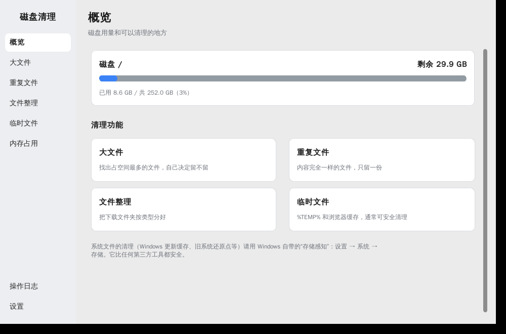
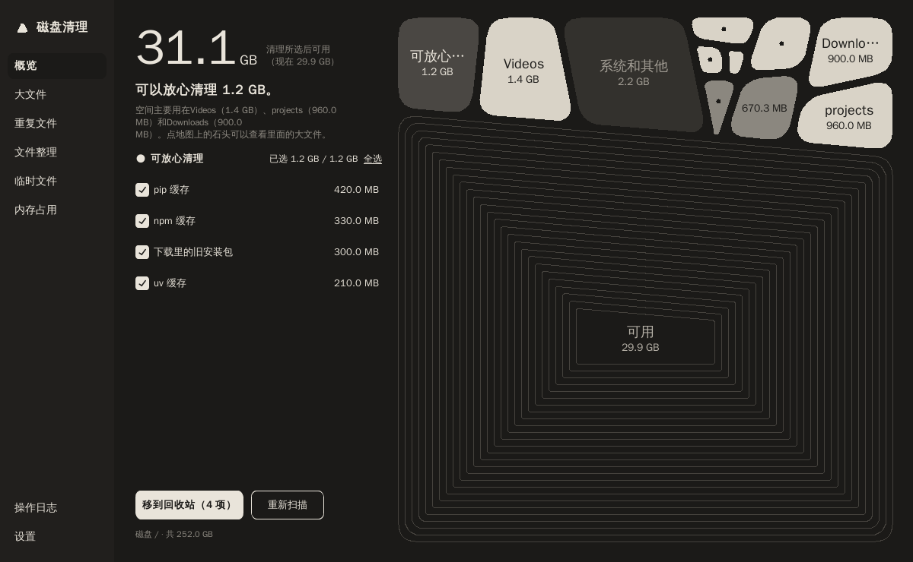
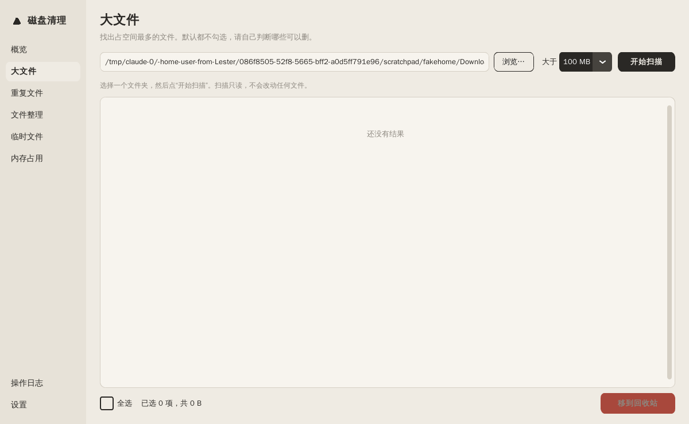

# 磁盘清理（Windows）

用 Python + CustomTkinter 做的磁盘清理和文件整理工具。**概览**、**大文件**、**操作日志** 三个页面可以用，其他页面是占位。



概览页：
- 左边：清理所选后能有多少可用空间、可放心清理的项目（临时文件、浏览器缓存、npm / pip / uv 缓存、下载里 30 天前的安装包），勾选后一键移到回收站
- 右边：石头地图。每块石头是一类空间，面积和大小成比例；墨黑是你的文件，深灰是程序，浅灰是缓存，米灰是系统，可用空间画成一圈圈等高线。鼠标停在石头上看详情，点“你的文件”类石头会跳到大文件页扫描那个文件夹
- 跟随系统的浅色 / 深色模式

| 深色模式 | 大文件 |
|---|---|
|  |  |

## 安全设计

- 扫描只读，不改动任何文件
- 删除一律用 `send2trash` **移到回收站**，可以恢复；代码里没有任何永久删除调用（有测试检查这一点）
- 删除前弹窗确认，写明数量、总大小和文件列表
- 不扫描、不删除系统目录：`C:\Windows`、`Program Files`、`ProgramData`、`pagefile.sys` 等（见 `core/safety.py`）
- `AppData` 默认也不删，只清理名单里的缓存目录里面的内容（`safety.py` 的 `SAFE_CACHES`）
- 回收站只显示大小，不提供“清空回收站”
- 不跟随符号链接和目录联接（junction）
- 每次删除都写日志到 `logs/YYYY-MM-DD.jsonl`，在“操作日志”页面可以查看

## 在 Windows 上运行

1. 安装 [Python 3.10+](https://www.python.org/downloads/)，安装时勾选 “Add python.exe to PATH”
2. 在这个文件夹里打开 PowerShell：

```bash
python -m venv .venv
```

```bash
.venv\Scripts\activate
```

```bash
pip install -r requirements.txt
```

```bash
python main.py
```

第一次在真实电脑上用之前，请先按 `docs/安全与流程.md` 最后的清单试一遍。

在浏览器里开发界面（后端是真的，会真的移动文件，请把 HOME / USERPROFILE 指向一个测试文件夹）：

```bash
python devserver.py
```

运行测试：

```bash
pip install pytest
```

```bash
python -m pytest tests
```

## 打包成 exe

```bash
pip install pyinstaller
```

```bash
pyinstaller --noconfirm --windowed --name 留白 --add-data "webui;webui" --collect-data customtkinter main.py
```

生成的程序在 `dist\留白\留白.exe`。清理记录和设置存在 `%LOCALAPPDATA%\Liubai\`。

## 项目结构

```
core/            界面无关的逻辑，可单独测试
  safety.py      受保护目录判断（扫描和删除都要经过这里）
  scanner.py     只读扫描器（后台线程、可取消、进度回调）
  space.py       统计空间都用在哪里（概览页）
  cleanables.py  可放心清理的项目
  fs.py          只读统计文件夹大小
  cleaner.py     唯一的删除入口：移到回收站 + 写日志
  oplog.py       操作日志
  utils.py       大小、时间格式化
ui/
  app.py         主窗口：左侧 150px 导航 + 右侧内容区，NAV 列表里加一项就多一个页面
  theme.py       颜色和字体；stone_theme.json 是 CustomTkinter 主题
  pebble_layout.py  石头地图的几何（切分、缩边、圆角）
  pebble_map.py     石头地图控件
  pages/         每个页面一个类
cli.py           命令行版本
main.py          图形界面入口
tests/           pytest 测试
CLAUDE.md        给 Claude Code 的规则（安全规则写在这里）
```

## 下一步（建议按顺序让 Claude Code 做）

1. **重复文件**：先按大小分组 → 比较前 64KB 的哈希 → 再比较完整 SHA-256；每组默认保留最早的一份
2. **文件整理**：下载文件夹按类型或月份分类，先预览，确认后移动，记录日志以便撤销
3. **临时文件**：概览页已经能清理常见缓存；这个页面可以列出每个缓存里的明细
4. **内存占用**：用 psutil 列出占内存最多的程序，由用户决定是否关闭
5. **设置**：外观、排除目录、日志保留天数

给 Claude Code 的示例指令：

```
按 CLAUDE.md 的规则实现"重复文件"页面：新建 core/duplicates.py（只读，后台线程，可取消），
再新建 ui/pages/duplicates.py 替换 ui/app.py 里的占位。先写 tests/ 里的测试，再写界面。
```
