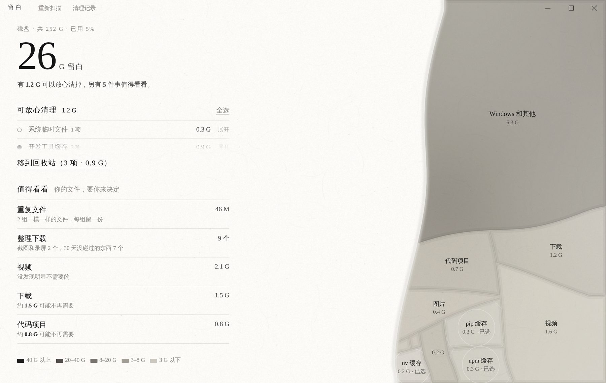
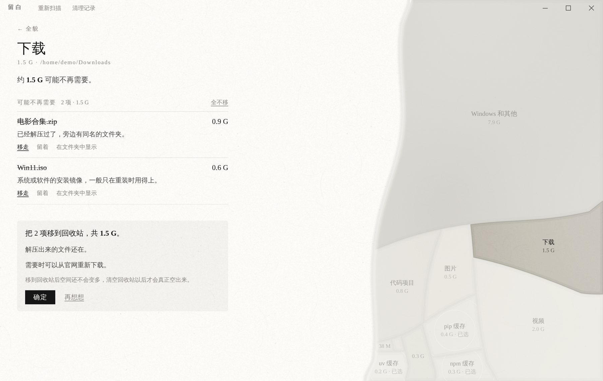
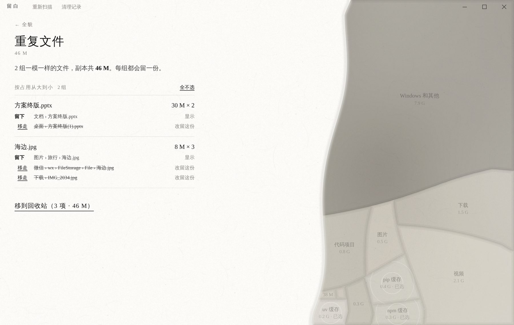
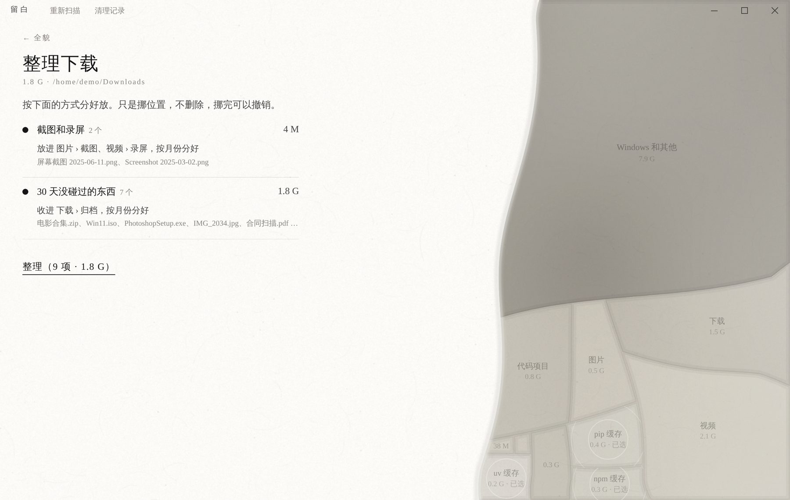

# 留白

一个 Windows 上的磁盘清理和文件整理工具。整个窗口是一张宣纸上的水墨：墨越深，占的空间越大；空着的纸，就是你的可用空间。



## 它能做什么

- **看清空间去哪了**：按类别画出来——微信聊天文件、代码项目、iPhone 备份、WSL / Docker 虚拟磁盘、页面文件……藏得再深的大块头也会单独列出来。
- **放心清理缓存**：临时文件、浏览器缓存、开发工具缓存等十几项，每一项都写明是什么、清了会怎样。
- **看看里面**：点开任何一块，用人话告诉你哪些可能不再需要，以及为什么——“已经解压过了”“和图片里那份一模一样”“2023 年以后没有改动过”。
- **重复文件**：找出内容一模一样的文件，每组只留一份，留哪一份可以改。
- **整理下载和桌面**：截图、录屏按月份收好，很久没碰的东西收进“归档”。只挪位置，不删除。
- **挪到别的盘**：自己拍的视频、写的东西，不建议删，可以挪到 D 盘或移动硬盘。
- **随时撤销**：挪走和整理的，一键放回原处；移到回收站的，在回收站里还原。

| 看看里面 | 重复文件 | 整理下载 |
|---|---|---|
|  |  |  |

## 它不会做什么

- **不会永久删除任何东西**。删除一律移到回收站；放不进回收站的（U 盘、网络盘、比回收站还大的文件），直接不动。
- **不会替你决定**。你的文件从不默认选中；每次动手前，都会原地告诉你要动什么、什么不会动。
- **不碰系统和程序**。Windows、Program Files、程序数据、OneDrive 里的文件一律不动。
- **不清空回收站**。清空了就找不回来，这一步留给你自己。
- **不联网，没有广告，没有弹窗。**

完整的规则见 [安全与流程](docs/安全与流程.md)。

## 安装和运行

需要 Windows 10 或 11，以及 [Python 3.10 以上](https://www.python.org/downloads/)（安装时勾选 “Add python.exe to PATH”）。

在项目文件夹里打开 PowerShell：

```bash
python -m venv .venv
```

```bash
.venv\Scripts\activate
```

```bash
pip install -r requirements.txt
```

```bash
python main.py
```

> 第一次在自己的电脑上用之前，请先按 [安全与流程](docs/安全与流程.md) 最后的清单试一遍。

## 文档

- [使用说明](docs/使用说明.md)：每个界面怎么用、常见问题
- [安全与流程](docs/安全与流程.md)：删除和移动的每一条规则，以及在 Windows 上要确认的事项
- [开发说明](docs/开发说明.md)：代码结构、怎么测试、怎么打包
- [更新记录](CHANGELOG.md)

## 打包成 exe

```bash
pip install pyinstaller
```

```bash
pyinstaller --noconfirm --windowed --name 留白 --add-data "webui;webui" --collect-data customtkinter main.py
```

生成的程序在 `dist\留白\留白.exe`。清理记录和设置保存在 `%LOCALAPPDATA%\Liubai\`。
